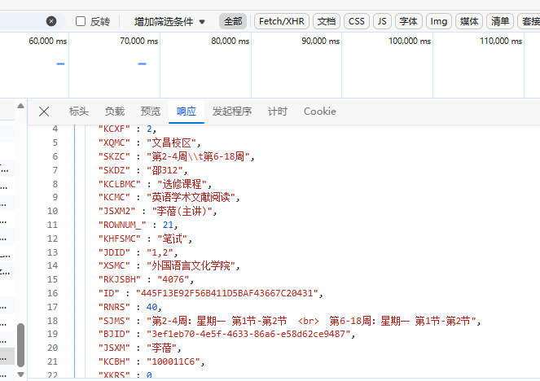
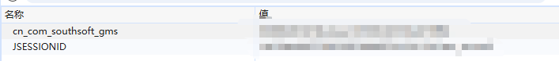

# CUMT 研究生选课/退课脚本

##  注意事项

> **严禁在选课时间之外使用本脚本！**


## 运行环境

* Python 3.10 或更高版本
* `requests` 库
* 可以正常访问教务系统的网络环境

安装依赖：

```powershell
py -3 -m pip install requests
```

检查 Python 版本：

```powershell
py -3 --version
```

## 快速开始

进入脚本所在目录：

直接启动：

```powershell
py -3 auto_request.py
```

程序会提示输入：

1. 一个或多个 `bjid`
2. 操作类型：`0` 表示退课，`1` 表示选课
3. `cn_com_southsoft_gms` 的值
4. `JSESSIONID` 的值

多个 `bjid` 可以使用逗号、中文逗号或空格分隔：

```text
ID1,ID2,ID3
```

两个 Cookie 值会分开输入：

```text
请输入 cn_com_southsoft_gms：你的值
请输入 JSESSIONID：你的值
```

如果使用 `--cookie`，仍可以粘贴带有请求头名称的完整内容：

```text
Cookie: cn_com_southsoft_gms=你的值; JSESSIONID=你的值
```

## 查看帮助

以下命令均可查看完整帮助：

```powershell
py -3 auto_request.py -help
py -3 auto_request.py --help
py -3 auto_request.py -h
```

## 使用示例

### 交互输入全部参数

```powershell
py -3 auto_request.py
```

### 指定一个 bjid

```powershell
py -3 auto_request.py --bjid "dab958ca-xxx-xxx"
```

Cookie 仍然由程序提示输入。

### 重复使用参数输入多个 bjid

```powershell
py -3 auto_request.py `
  --bjid "ID1" `
  --bjid "ID2" `
  --bjid "ID3"
```

### 使用一个参数输入多个 bjid

```powershell
py -3 auto_request.py --bjid "ID1,ID2,ID3"
```

也可以使用空格分隔，但整个参数需要放在英文双引号内：

```powershell
py -3 auto_request.py --bjid "ID1 ID2 ID3"
```

### 设置并发线程数

```powershell
py -3 auto_request.py --bjid "ID1,ID2,ID3" --workers 3
```

默认线程数等于 `bjid` 数量，但最多为 5。线程数不会超过实际的 `bjid` 数量。

### 设置满员后的重试间隔

```powershell
py -3 auto_request.py --bjid "ID1,ID2" --interval 1.5
```

上述命令在服务器明确提示教学班满员后等待 1.5 秒，再发送下一次请求。
如果服务器提示“已选该班级，请勿重复选择”，脚本会将其视为已选成功并停止该班级的重试；
院系限制等其他业务失败也会停止重试并如实显示原因。

### 设置请求超时

```powershell
py -3 auto_request.py --bjid "ID1,ID2" --timeout 10
```

单次请求的默认超时时间为 8 秒。

### 设置连续网络错误上限

```powershell
py -3 auto_request.py --bjid "ID1,ID2" --max-network-errors 10
```

默认情况下，一个 `bjid` 连续发生 5 次网络错误后会停止。设置为 `0` 表示不限制连续网络错误次数：

```powershell
py -3 auto_request.py --bjid "ID1,ID2" --max-network-errors 0
```

### 通过命令行提供 Cookie

```powershell
py -3 auto_request.py `
  --bjid "ID1,ID2" `
  --cookie "cn_com_southsoft_gms=你的值; JSESSIONID=你的值"
```


## 参数说明

|参数|是否必需|默认值|说明|
|-|-|-|-|
|`-h`、`--help`、`-help`|否|无|显示帮助信息并退出|
|`--bjid`|是|交互输入|教学班 ID，可以重复使用此参数，也可以一次输入多个值|
|`--cookie`|是|交互输入|包含 `cn_com_southsoft_gms` 和 `JSESSIONID` 的 Cookie|
|`--workers`|否|最多 5|并发线程数|
|`--interval`|否|`1.0`|满员后的重试间隔，单位为秒|
|`--timeout`|否|`8.0`|单次 HTTP 请求超时，单位为秒|
|`--max-network-errors`|否|`5`|每个 `bjid` 允许的连续网络错误次数，`0` 表示不限制|
|`--pdid`|否|无|用于生成可选的 `Referer` 请求头|

## bjid 和 Cookie

### bjid

`bjid` 是具体教学班的 ID，格式通常为 UUID，例如：

```text
dab958ca-xxx-xxx
```

它会作为 POST 请求体的一部分发送：

```text
lb=1&bjid=教学班ID
```

脚本会检查 `bjid` 是否符合标准 UUID 格式。如果格式不正确，程序会在发送请求前停止并显示错误。

#### 关于获取bjid
登录研究生系统
1.前往课程计划制定，确保课程已制定，复制你要获取的课程名称或编号
2.打开开发者工具选择network
3.点击右上角的查询方案中开课课程及时间
4.粘贴课程名称或编号
5.在network翻看响应查找这个请求，里面会有课程的bjid


### Cookie

脚本要求 Cookie 至少包含：

* `cn_com_southsoft_gms`
* `JSESSIONID`


#### 关于获取cookie
登录系统后打开开发者工具
选择应用程序->找到cookie

