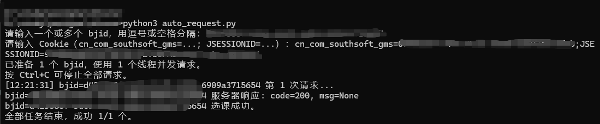
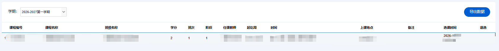

# CUMT 研究生选课/退课及课程评价脚本

##  注意事项

> **严禁在选课时间之外使用本脚本！**



## 运行环境

* Python 3.10 或更高版本
* `requests` 库
* 可以正常访问教务系统的网络环境

安装依赖：

```powershell
py -3 -m pip install requests
```

## 可选：课程评价

课程评价使用独立脚本，不会影响原有选课/退课流程。查询和提交都需要有效的两个 Cookie。

### 批量评价

直接启动交互模式：

```powershell
py -3 batch_evaluation.py
```

按提示输入两个 Cookie，查看未评价课程和教师列表，输入要评价的序号（例如 `1,3,5`），或直接回车选择全部；然后输入学号，确认模板 ID。默认模板 ID 来自提供的抓包，请确认它适用于所选课程。同一教学班的不同教师会分别评价。

根据评价前后的列表样本，脚本跳过 `ZT=1` 的已评价条目；没有 `ZT`、`TJID` 和 `PJJG` 的条目按未评价处理。其他含评价状态字段但状态无法确认的条目会跳过并提示。最终确认前会重新查询列表，排除期间已评价、状态不明或已不在列表中的条目。`YXPJ` 和 `SFBP` 的含义未确认，不用于判断是否已评价。

脚本为每位教师随机生成分数，并把“有无违背党和国家大政方针、违背宪法法律、危害国家安全、破坏民族团结等言行”固定为“否”（`czyc=0`）。提交前会显示每门课程、教师、评价项目、分数、固定选项和总分；只有输入 `批量提交评价` 才开始逐项发送。若不确认，可输入其他内容或按 Ctrl+C 退出。

批量提交时，每两条评价之间会随机等待 30～60 秒，等待期间可以按 Ctrl+C 停止。一旦请求状态不明或响应不是明确的 `code=200`，脚本会停止后续提交。已发送的条目不会撤销，请先到系统核对再决定如何处理剩余条目。所有所选课程都使用同一模板 ID，若课程使用不同模板，应分批操作。

如需将生成和提交分开执行，运行 `py -3 batch_evaluation.py --help` 查看文件模式及其他参数。

### 单个评价

查询评价列表（原样显示服务器 JSON）：

```powershell
py -3 course_evaluation.py list
```

根据列表和评价页面的信息查询模板：

```powershell
py -3 course_evaluation.py template --mbid "模板ID" --bjid "教学班UUID" --jsbh "教师编号"
```

模板请求中的 `mbid` 来自模板信息；评价页面 Referer 中的 `mbid` 和 `pjid` 默认均为空，如实际请求中不为空，可分别使用 `--referer-mbid` 和 `--pjid` 指定。列表中同一个 `BJID` 可能对应多位教师，请按 `BJID` 和 `JSBH` 两项选择评价对象。查询结果会原样显示。

按已提供的模板随机生成评价文件：

```powershell
py -3 course_evaluation.py prepare --mbid "模板ID" --bjid "教学班UUID" `
  --jsbh "教师编号" --xh "本人学号" --output evaluation.json
```

该命令查询模板后生成文件，不会提交。抓包中的模板 ID 为 `23B8965E784CB2111798A9F65F2BDB7F`，请确认适用于所选课程。也可以通过 `--template-file template.json` 使用已保存的模板响应；使用本地模板时无需 Cookie，也不会发送网络请求。输出文件已存在时不会覆盖。

根据给出的示例，脚本将 `GCDQZ` 为 `0.10` 的题目视为 10 分题，随机选 9 或 10 分；将 `0.05` 的题目视为 5 分题，随机选 4 或 5 分，并将各题得分相加作为 `pjjg`。这一计算方式是依据提供的模板及提交样例推断的，请在提交前核对题目和分数。遇到其他权重、权重总和不为 1 或模板 ID 不一致时，脚本会停止生成，避免套用不适用的规则。

如需提交，先根据实际模板和自己的选择准备 UTF-8 JSON 文件，例如 `evaluation.json`：

```json
{
  "czyc": "0",
  "mbid": "实际模板ID",
  "bjid": "实际教学班UUID",
  "jsbh": "实际教师编号",
  "xh": "本人学号",
  "qtyj": "",
  "xxnrlist": [
    {"gcdid": "实际题目ID", "xxnrid": "实际选项ID"}
  ],
  "zt": "1",
  "pjjg": "实际评价结果"
}
```

上面只是字段格式示例，手动填写时须按实际模板填写所有题目、选项和评价结果。`xh`、教师编号等请保持字符串，避免丢失前导零。填写或生成完毕并检查后运行：

```powershell
py -3 course_evaluation.py submit --file evaluation.json
```

提交前脚本会查询模板，逐项展示题目名称和将发送的分数，同时展示总分和完整内容；只有交互输入 `提交评价` 才会发送评价。也可在 `submit` 命令中添加 `--template-file template.json`，使用本地模板核对题目。模板 ID、题目 ID 或名称不匹配时会停止提交。服务器响应会原样显示，请结合教务系统页面核对提交结果；如果请求超时或断线，先检查系统中的状态，再决定是否重试。该脚本不会保存 Cookie；JSON 文件可能包含个人信息，请妥善保管。

也可在子命令之前传入 `--cookie "cn_com_southsoft_gms=...; JSESSIONID=..."` 或 `--timeout 10`；注意命令行参数可能被 shell 历史记录保存。

检查 Python 版本：

```powershell
py -3 --version
```

## 快速开始

进入脚本所在目录：

直接启动：

```powershell
py -3 auto_request.py
```

程序会提示输入：

1. 一个或多个 `bjid`
2. 操作类型：`0` 表示退课，`1` 表示选课
3. `cn_com_southsoft_gms` 的值
4. `JSESSIONID` 的值

多个 `bjid` 可以使用逗号、中文逗号或空格分隔：

```text
ID1,ID2,ID3
```

两个 Cookie 值会分开输入：

```text
请输入 cn_com_southsoft_gms：你的值
请输入 JSESSIONID：你的值
```

如果使用 `--cookie`，仍可以粘贴带有请求头名称的完整内容：

```text
Cookie: cn_com_southsoft_gms=你的值; JSESSIONID=你的值
```

## 查看帮助

以下命令均可查看完整帮助：

```powershell
py -3 auto_request.py -help
py -3 auto_request.py --help
py -3 auto_request.py -h
```

## 使用示例

### 交互输入全部参数

```powershell
py -3 auto_request.py
```

### 指定一个 bjid

```powershell
py -3 auto_request.py --bjid "dab958ca-xxx-xxx"
```

Cookie 仍然由程序提示输入。

### 重复使用参数输入多个 bjid

```powershell
py -3 auto_request.py `
  --bjid "ID1" `
  --bjid "ID2" `
  --bjid "ID3"
```

### 使用一个参数输入多个 bjid

```powershell
py -3 auto_request.py --bjid "ID1,ID2,ID3"
```

也可以使用空格分隔，但整个参数需要放在英文双引号内：

```powershell
py -3 auto_request.py --bjid "ID1 ID2 ID3"
```

### 设置并发线程数

```powershell
py -3 auto_request.py --bjid "ID1,ID2,ID3" --workers 3
```

默认线程数等于 `bjid` 数量，但最多为 5。线程数不会超过实际的 `bjid` 数量。

### 设置满员后的重试间隔

```powershell
py -3 auto_request.py --bjid "ID1,ID2" --interval 1.5
```

上述命令在服务器明确提示教学班满员后等待 1.5 秒，再发送下一次请求。
如果服务器提示“已选该班级，请勿重复选择”，脚本会将其视为已选成功并停止该班级的重试；
院系限制等其他业务失败也会停止重试并如实显示原因。

### 设置请求超时

```powershell
py -3 auto_request.py --bjid "ID1,ID2" --timeout 10
```

单次请求的默认超时时间为 8 秒。

### 设置连续网络错误上限

```powershell
py -3 auto_request.py --bjid "ID1,ID2" --max-network-errors 10
```

默认情况下，一个 `bjid` 连续发生 5 次网络错误后会停止。设置为 `0` 表示不限制连续网络错误次数：

```powershell
py -3 auto_request.py --bjid "ID1,ID2" --max-network-errors 0
```

### 通过命令行提供 Cookie

```powershell
py -3 auto_request.py `
  --bjid "ID1,ID2" `
  --cookie "cn_com_southsoft_gms=你的值; JSESSIONID=你的值"
```


## 参数说明

|参数|是否必需|默认值|说明|
|-|-|-|-|
|`-h`、`--help`、`-help`|否|无|显示帮助信息并退出|
|`--bjid`|是|交互输入|教学班 ID，可以重复使用此参数，也可以一次输入多个值|
|`--cookie`|是|交互输入|包含 `cn_com_southsoft_gms` 和 `JSESSIONID` 的 Cookie|
|`--workers`|否|最多 5|并发线程数|
|`--interval`|否|`1.0`|满员后的重试间隔，单位为秒|
|`--timeout`|否|`8.0`|单次 HTTP 请求超时，单位为秒|
|`--max-network-errors`|否|`5`|每个 `bjid` 允许的连续网络错误次数，`0` 表示不限制|
|`--pdid`|否|无|用于生成可选的 `Referer` 请求头|

## bjid 和 Cookie

### bjid

`bjid` 是具体教学班的 ID，格式通常为 UUID，例如：

```text
dab958ca-xxx-xxx
```

它会作为 POST 请求体的一部分发送：

```text
lb=1&bjid=教学班ID
```

脚本会检查 `bjid` 是否符合标准 UUID 格式。如果格式不正确，程序会在发送请求前停止并显示错误。

#### 关于获取bjid
登录研究生系统
1.前往课程计划制定，确保课程已制定，复制你要获取的课程名称或编号
2.打开开发者工具选择network
3.点击右上角的查询方案中开课课程及时间
4.粘贴课程名称或编号
5.在network翻看响应查找这个请求，里面会有课程的bjid


### Cookie

脚本要求 Cookie 至少包含：

* `cn_com_southsoft_gms`
* `JSESSIONID`


#### 关于获取cookie
登录系统后打开开发者工具
选择应用程序->找到cookie

